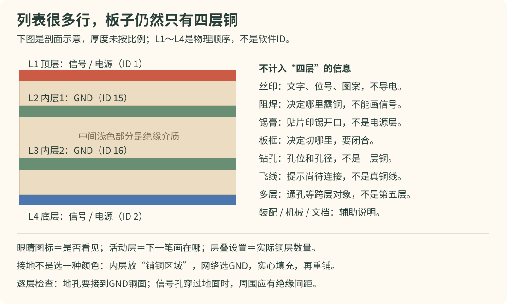

# 00 先认清工程和层

[返回学习路线](README.md) · [下一课：元器件](01-元器件与最小电路.md)

## 目标

这一课只学一件事：分清“电路连什么”和“铜线画在哪里”。完成后能打开正确图纸、识别四层，并掌握后面各课共用的操作。

## 器件与接线

本课不放器件、不通电。只需要现有嘉立创专业版 V4 工程。先打开 Board1 下的 Schematic1/P1，再打开同一 Board1 下的 PCB1；最后只读查看 Board2/PCB2。

## 四个不同的东西

| 名称 | 日常理解 | 你在这里做什么 |
| --- | --- | --- |
| 原理图 Schematic | 写清谁与谁相连的关系图 | 选元件、给引脚接线、标电压和网名，不决定铜线在第几层 |
| PCB | 真正生产出来的板子 | 确定板框、孔、元件位置及每一段铜线 |
| 板子 Board | 把某份原理图与某份 PCB 配成一组 | 确保 Board1 的改动传到 PCB1，而不是 PCB2 |
| 拼板 Panel | 把已设计好的小板组合成加工用大板 | 初学先不用 Panel2，不在里面改电路 |

P1、“主控与交互”等是**图纸页**，不是铜层。原理图有五页与 PCB 有四层没有对应关系；五页的网络可以一起落在同一块四层板上。

## 为什么右边列出很多层

“四层板”只数**导电铜层**。软件还需要记录文字、阻焊开窗、锡膏开口、钻孔、外形和装配信息，所以列表远不止四行。

正式 PCB2 的现场回读如下。表中 L1～L4 是从板子上往下数的物理顺序；ID 是软件内部编号，**底层 ID=2 仍然处在物理第四层**。

| 物理顺序 | 软件名称 | 当前内部ID，仅用于解释 | 本板用途 |
| --- | --- | --- | --- |
| L1 | 顶层 / Top Layer | 1 | 元件焊盘、信号线、电源线 |
| L2 | 内层1 / Inner1 | 15 | 连续 GND 铜面 |
| L3 | 内层2 / Inner2 | 16 | 连续 GND 铜面 |
| L4 | 底层 / Bottom Layer | 2 | 信号线、电源线，可放底面元件 |

本板两内层在软件中可以显示为 SIGNAL 类型，仍通过**指定网络为 GND 的实心铺铜**形成地面。不是非要把类型改成 PLANE 才能接地，也不要改了类型却不检查实际铜。

| 其他常见层 | 用来做什么 | 初学怎样处理 |
| --- | --- | --- |
| 顶/底丝印 | 板面上的位号、文字、图案 | 放文字；不能用它连电路 |
| 顶/底阻焊 | 决定哪里露出焊接铜面、哪里覆盖绝缘油墨 | 开窗通常随焊盘生成；不要手动画当电线 |
| 顶/底锡膏、钢网 | 决定贴片时锡膏印在哪里 | 通常随贴片焊盘生成；不是电源层 |
| 顶/底装配 | 元件轮廓与装配标记 | 检查装配时看；不当制造丝印使用 |
| 板框 | 决定板子切割的外形 | 用板框工具画闭合外轮廓；不是普通丝印矩形 |
| 多层 / Multi-Layer | 通孔焊盘、过孔等跨层对象的表示 | 不是第五个独立铜层，也不代表孔自动接所有网络 |
| 机械、文档 | 尺寸、说明等辅助信息 | 辅助阅读；不拿来布信号线 |
| 孔、钻孔图 | 孔位、孔径、加工说明 | 检查孔；一条画出的圆线不等于真实孔 |
| 飞线 / Ratline | 还需要连通的两点之间的提示细线 | 是待办提示，不是已经生产出来的铜线 |
| 元件外形/标识、引脚焊接/悬空 | 编辑器的轮廓和检查辅助显示 | 用于检查，不增加铜层数 |
| 3D外壳/顶面/底面 | 外壳或三维相关辅助内容 | 不用来布线，不因此增加铜层 |

列表还可能显示未启用的 Inner3、Inner4 或预留自定义层。这些不代表本板已经使用它们；以**层叠设置中的铜层数量和制造输出**为准。

## 操作：先掌握六件小事

以下按 V4 的功能名称描述。语言/小版本可能把入口放在不同菜单；先确认当前激活的是原理图还是 PCB，工具栏随文档类型变化。不依赖未经核对的快捷键。

1. **打开图纸**：双击左侧工程树中的 P1 或 PCB1。看画布标签标题确认，不只看左侧选中颜色。
2. **选中和属性**：单击对象，看右侧属性。放件后可在属性中改位号、参数、旋转；看清选中的是元件、文字、焊盘还是线。
3. **退出工具**：按 Esc 退出当前连续放置/连线；必要时再按一次，直到鼠标回到普通选择状态。放错立刻撤销一次，再看结果，不连续盲撤销。
4. **看层**：在 PCB 右侧图层列表点可见性图标。先隐藏装配、机械等辅助显示，保留铜层、板框、焊盘与飞线，观察画面变化；不要删除层或图元来“清爽”。
5. **选活动层**：点击要绘制的铜层名称，确认活动层高亮或布线工具属性显示该层。**可见不等于当前可画，隐藏也不等于从生产中删除。**
6. **保存**：保存当前文档，确认没有待保存提示；完成一课保存所有已修改文档。关闭并重新打开该图纸，核对刚才的修改仍存在。

不会选中元件时，先退出布线工具并检查选择过滤器是否允许选择元件；不要为了移动元件把封装解散。缩放和平移可以使用触控板或鼠标，但不改变任何电气连接。

## 现象与电路解释

在 PCB2 关闭丝印显示，文字消失但铜线还在；隐藏 Inner1，画面少一层，但四层叠层设置不变。原理图的 `GND` 是“哪些脚属于同一组”；PCB 的 Inner1/Inner2 是“这组地铜放在板厚的哪里”。

电流要走完整回路：电源正端→负载→GND→电源负端。GND 是本电路的电压参考点与回流网络；USB 小设备的 GND 不等于必须插入墙上保护地。

## 常见错误

| 误解 | 正确操作 |
| --- | --- |
| 原理图画粗一点就是大电流线 | 原理图线只是连接关系；PCB 中另设线宽、铜厚和过孔能力 |
| 选中内层就把所有地自动放上去了 | 内层必须有指定 GND 的实际铜，并接到相应焊盘/地过孔 |
| 所有红色都是电源、蓝色都是地 | 颜色可配置，通常主要表示层；看对象的网络属性 |
| 想用四层就把别的显示层删掉 | 在层叠设置中设四铜层，工艺图层保留 |
| P1 同名可以随便选 | 本工程两个原理图都有 P1，必须先看所属 Board/Schematic |

## 过关标准与最终项目的关系

- [ ] 能找到 Board1/P1、PCB1、Board2/PCB2，且知道正式板在哪。
- [ ] 能指出四铜层和两种非铜层，能解释眼睛图标与活动层的差别。
- [ ] 能选中对象查看网络、退出工具、保存和重开。

正式载板就是同样的原理：更多元件和网络共同使用这四层，而不是每个模块分配一层。
