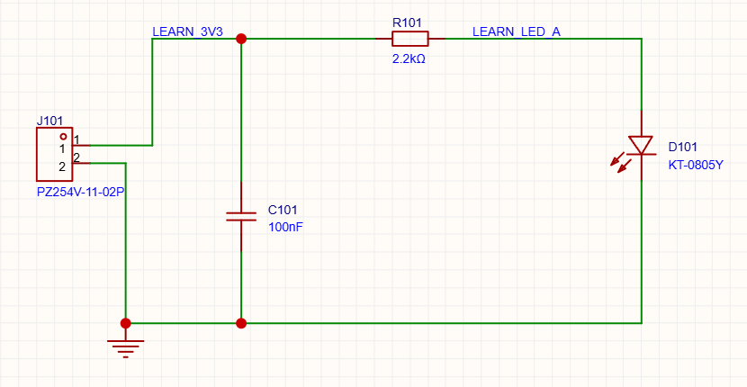

# 00 第一次操作：先找到图，再认图

[返回学习路线](README.md) · [下一课：元器件](01-元器件与最小电路.md)

## 现在只做什么

本课只做五个小动作：打开目录、打开电路图、点中一个电阻、看板子、切换文字显示。**不画线，不改参数，不新建板子。**

准备电脑和嘉立创即可，不需要任何实物元件。工程已经打开就从00-1开始；还没打开，先按下面两步做。

1. 按 `Win+E` 打开文件资源管理器，在上方地址栏粘贴 `D:\develop\embedded-ai-home-lab\projects\homeguard-mini\eda\HomeGuard Mini 载板 R1 20261111`，按回车。
2. 双击里面的 `HomeGuard Mini 载板 R1 20261111.eprj3`，等待嘉立创打开工程。若系统提示没有关联程序，在嘉立创里用本地工程打开功能选择这个文件，不把它作为图片导入。

下面每一步先做完，再读下一步。

## 00-1：先确认打开的是学习目录

1. 看软件**左侧**，找到 `Board1`。这里的一串名字像文件夹目录，用来找不同图纸，叫“工程树”。
2. 如果Board1左边有小三角，点一下小三角展开；已经展开就不用再点。
3. 找到Board1里面的 `Schematic1`，同样展开。
4. 找到下面的 `P2`，用鼠标左键快速点两下，也就是“双击”。

**应该看到：** 中间出现中文学习路线。`P2`是这一份原理图的第二页，不是第二块PCB。

找不到Board1时，先看工程名称是不是 `HomeGuard Mini 载板 R1 20261111`。只有空白首页，说明工程尚未打开，回本课开头的两步。这里只打开P2看一眼，先不按图中的整条路线操作。

## 00-2：打开真正的电路图

1. 仍看左侧同一个 `Schematic1`，找到 `P1`，双击。
2. 看软件中间。左侧应有几条线和四个小图形，右侧是中文说明卡。
3. 找四个名字：`J101`、`R101`、`D101`、`C101`。先找到名字，不要求现在读懂线。

**应该看到的电路局部如下。** 这是现有P1导出的图，不是要你照着新建的窗口，也不是让你在这张图片上操作：

若图太小，把鼠标放在电路附近，缓慢滚动滚轮，观察放大/缩小。不同滚轮设置方向可能相反，以画面变化为准。先只缩放，不按住元件拖动。

**到这里就能分清两种东西：** 左侧元件和导线是可编辑电路；右侧中文卡是讲解图片。后面点元件时，要点左侧电路里的小图形。

## 00-3：点中一个电阻，这是今天的第一个成果

1. 找到电路**上方**写着 `R101` 的小长方框。
2. 先按一下键盘左上角的 `Esc`，让软件退出可能正在使用的工具。
3. 在这个**小长方框本体**上单击一次。不按住拖动，也不点右侧说明卡里的“R101”文字。
4. 看软件**右侧**出现的属性。属性就是“这个东西叫什么、数值是多少”的说明。
5. 找到位号 `R101`，再找参数 `2.2kΩ` 或 `2.2k`。其中 `k` 表示一千，所以它等于2200Ω；Ω是电阻大小的单位，读“欧姆”。
6. 再按一下 `Esc` 取消选择。

**完成标志：** 你可以说“我点中了R101，它是一个2.2kΩ电阻”。本课做到这一步，已经有成果了。

| 遇到什么 | 现在怎么处理 |
| --- | --- |
| 整块中文卡被选中 | 点到了讲解图片；按Esc，回左侧电路找小长方框 |
| 只选中了“R101”几个字 | 按Esc，再点文字下方的长方框本体 |
| 元件跟着鼠标走了 | 按Esc退出移动；若已经放到新位置，立即撤销这一次移动，再核对恢复 |
| 右边没有元件属性 | 先确认确实选中了本体，再找界面的属性面板；不要为看到属性而双击修改数值 |

## 00-4：看同一块电路变成板子的样子

1. 回左侧 `Board1`，找到 `PCB1`。它不在P1～P5这几页里面，与Schematic1是同一个Board下面的配对文档。
2. 双击 `PCB1`。
3. 中间应该出现一块小长方形板，元件已经放好，线已经画好。
4. 找板上的 `J101`、`R101`、`D101`、`C101`，和刚才P1里的名字对照。

**应该看到：** 原理图用小图形表示“谁接谁”，PCB用实际焊盘和铜线表示“东西放哪里、线走哪里”。它们表达的是同一个电路。

PCB1不是空板，是已经完成的参考答案。现在不往里面加东西，也不用连开发板去测试。

## 00-5：只让板上的字消失，再恢复

1. 保持PCB1打开，在界面右侧找图层列表，即包含“顶层、底层、顶层丝印”等名字的区域。
2. 找到 **顶层丝印**。丝印就是以后印在板面上的文字，例如 `R101`，不是导电铜线。
3. 先看它当前是否可见，再点这一行旁边的可见性图标，观察文字隐藏/显示。不要点删除，也不改层属性。
4. 再点一次，恢复原来的显示状态。

**完成标志：** 顶面文字会隐藏和恢复，但元件焊盘、铜线不会因为隐藏文字而消失。只切换显示就够了，不用修改PCB内容。

右侧显示很多层很正常。现在只记住：**本板只有四层导电铜；“丝印、阻焊、钻孔”等是其他制造信息，不会让四层变成十几层。** 这句话能理解，就可以先不背下面的大表。

## 本课做到这里就可以停

- [ ] 我能在Board1里分别打开P1和PCB1。
- [ ] 我能点中真实R101，并看到2.2kΩ。
- [ ] 我能隐藏并恢复顶层丝印，知道文字层不是铜层。

三个都能做，就打开[第01课](01-元器件与最小电路.md)，继续认这四个元件。**先不要新建工程，也不要转PCB。** 如果还做不到，就留在对应的00-1～00-5排查，不需要读后面六课。

## 用到时再查：工程和图层词典

下面是解释，不是新的操作任务。需要详细理解四个铜层时，也可以打开工程内 `Schematic1 / P3` 对照。

## 四个不同的东西

| 名称 | 日常理解 | 你在这里做什么 |
| --- | --- | --- |
| 原理图 Schematic | 写清谁与谁相连的关系图 | 选元件、给引脚接线、标电压和网名，不决定铜线在第几层 |
| PCB | 真正生产出来的板子 | 确定板框、孔、元件位置及每一段铜线 |
| 板子 Board | 把某份原理图与某份 PCB 配成一组 | 确保 Board1 的改动传到 PCB1，而不是 PCB2 |
| 拼板 Panel | 把已设计好的小板组合成加工用大板 | 初学先不用 Panel2，不在里面改电路 |

P1、“主控与交互”等是**图纸页**，不是铜层。原理图有五页与 PCB 有四层没有对应关系；五页的网络可以一起落在同一块四层板上。

## 为什么右边列出很多层

“四层板”只数**导电铜层**。软件还需要记录文字、阻焊开窗、锡膏开口、钻孔、外形和装配信息，所以列表远不止四行。

正式 PCB2 的现场回读如下。表中 L1～L4 是从板子上往下数的物理顺序；ID 是软件内部编号，**底层 ID=2 仍然处在物理第四层**。

| 物理顺序 | 软件名称 | 当前内部ID，仅用于解释 | 本板用途 |
| --- | --- | --- | --- |
| L1 | 顶层 / Top Layer | 1 | 元件焊盘、信号线、电源线 |
| L2 | 内层1 / Inner1 | 15 | 连续 GND 铜面 |
| L3 | 内层2 / Inner2 | 16 | 连续 GND 铜面 |
| L4 | 底层 / Bottom Layer | 2 | 信号线、电源线，可放底面元件 |

本板两内层在软件中可以显示为 SIGNAL 类型，仍通过**指定网络为 GND 的实心铺铜**形成地面。不是非要把类型改成 PLANE 才能接地，也不要改了类型却不检查实际铜。

| 其他常见层 | 用来做什么 | 初学怎样处理 |
| --- | --- | --- |
| 顶/底丝印 | 板面上的位号、文字、图案 | 放文字；不能用它连电路 |
| 顶/底阻焊 | 决定哪里露出焊接铜面、哪里覆盖绝缘油墨 | 开窗通常随焊盘生成；不要手动画当电线 |
| 顶/底锡膏、钢网 | 决定贴片时锡膏印在哪里 | 通常随贴片焊盘生成；不是电源层 |
| 顶/底装配 | 元件轮廓与装配标记 | 检查装配时看；不当制造丝印使用 |
| 板框 | 决定板子切割的外形 | 用板框工具画闭合外轮廓；不是普通丝印矩形 |
| 多层 / Multi-Layer | 通孔焊盘、过孔等跨层对象的表示 | 不是第五个独立铜层，也不代表孔自动接所有网络 |
| 机械、文档 | 尺寸、说明等辅助信息 | 辅助阅读；不拿来布信号线 |
| 孔、钻孔图 | 孔位、孔径、加工说明 | 检查孔；一条画出的圆线不等于真实孔 |
| 飞线 / Ratline | 还需要连通的两点之间的提示细线 | 是待办提示，不是已经生产出来的铜线 |
| 元件外形/标识、引脚焊接/悬空 | 编辑器的轮廓和检查辅助显示 | 用于检查，不增加铜层数 |
| 3D外壳/顶面/底面 | 外壳或三维相关辅助内容 | 不用来布线，不因此增加铜层 |

列表还可能显示未启用的 Inner3、Inner4 或预留自定义层。这些不代表本板已经使用它们；以**层叠设置中的铜层数量和制造输出**为准。

## 用到时再查：选中、活动层与保存

以下按 V4 的功能名称描述。语言/小版本可能把入口放在不同菜单；先确认当前激活的是原理图还是 PCB，工具栏随文档类型变化。不依赖未经核对的快捷键。

1. **打开图纸**：双击左侧工程树中的 P1 或 PCB1。看画布标签标题及所属原理图确认，不只看左侧选中颜色。
2. **选中和属性**：单击对象，看右侧属性。放件后可在属性中改位号、参数、旋转；看清选中的是元件、文字、焊盘还是线。
3. **退出工具**：按 Esc 退出当前连续放置/连线；必要时再按一次，直到鼠标回到普通选择状态。放错立刻撤销一次，再看结果，不连续盲撤销。
4. **看层**：在 PCB 右侧图层列表点可见性图标。先隐藏装配、机械等辅助显示，保留铜层、板框、焊盘与飞线，观察画面变化；不要删除层或图元来“清爽”。
5. **选活动层**：点击要绘制的铜层名称，确认活动层高亮或布线工具属性显示该层。**可见不等于当前可画，隐藏也不等于从生产中删除。**
6. **保存**：保存当前文档，确认没有待保存提示；完成一课保存所有已修改文档。关闭并重新打开该图纸，核对刚才的修改仍存在。

不会选中元件时，先退出布线工具并检查选择过滤器是否允许选择元件；不要为了移动元件把封装解散。缩放和平移可以使用触控板或鼠标，但不改变任何电气连接。

## 用到时再查：电流回路

在 PCB1 关闭丝印显示，文字消失但铜线还在；隐藏 Inner1，画面少一层，但四层叠层设置不变。原理图的 `GND` 是“哪些脚属于同一组”；PCB 的 Inner1/Inner2 是“这组地铜放在板厚的哪里”。

电流要走完整回路：电源正端→负载→GND→电源负端。GND 是本电路的电压参考点与回流网络；USB 小设备的 GND 不等于必须插入墙上保护地。

## 常见错误

| 误解 | 正确操作 |
| --- | --- |
| 原理图画粗一点就是大电流线 | 原理图线只是连接关系；PCB 中另设线宽、铜厚和过孔能力 |
| 选中内层就把所有地自动放上去了 | 内层必须有指定 GND 的实际铜，并接到相应焊盘/地过孔 |
| 所有红色都是电源、蓝色都是地 | 颜色可配置，通常主要表示层；看对象的网络属性 |
| 想用四层就把别的显示层删掉 | 在层叠设置中设四铜层，工艺图层保留 |
| P1 同名可以随便选 | 本工程两个原理图都有 P1，必须先看所属 Board/Schematic |

## 与最终项目的关系

正式载板就是同样的原理：更多元件和网络共同使用这四层，而不是每个模块分配一层。
