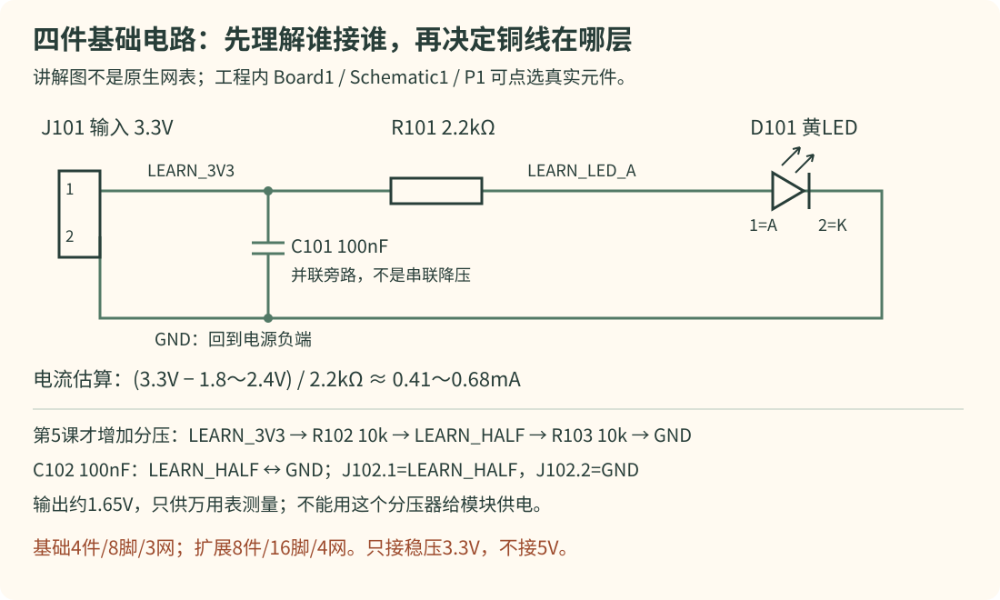

# 01 一次认识一个元件

[上一课](00-认识工程与图层.md) · [返回开始页](README.md)

保持 **Board1 → Schematic1 → P1** 打开。本课只看现成电路，不改数值，不买元件。

## 01-1：先认识刚才点过的R101

点一下R101的小长方框，看右侧的2.2kΩ。**它是电阻，负责限制流过灯的电流。** 电流太大可能损坏灯，所以后面画图时不能把电阻换成一根导线。

**过关：你能指出R101，并说“它用来限流”。** 先记用途，暂时不用算电流。

01-1过关后，再看01-2：认识灯

## 01-2：只认识D101

按Esc取消选择，再点电路右侧的D101本体。

它是会发光的LED。**它有方向：1脚是A，2脚是K。** 现在不用接线，只在图上找到它。

**过关：你能指出D101，知道它是灯而且不能随意接反。** 下一步再看电容。

01-2过关后，再看01-3：认识电容

## 01-3：只认识C101

按Esc，再点下方两条平行短线构成的C101，核对参数100nF。

它是电容，本例用来减小电源的快速波动。**100nF是容量，先能认出这个数即可；它不能把5V变成3.3V。**

**过关：你能指出C101，知道它与电阻、灯是不同元件。** 下一步再看接口。

01-3过关后，再看01-4：认识电源接口

## 01-4：只认识J101

按Esc，再点左侧的J101方框，找到编号1和2。

它是两针接口，以后让外部电源接进来：**1脚接稳压3.3V，2脚接GND，也就是本电路的电源负端。** 今天只在软件看，不实际通电。

**过关：你能指出J101，并找到它的两只脚。** 这里的J101/R101等是元件名字，不是ESP32的GPIO编号。

四件都认出了，再看下一步

四件可以分开认，不要求一次背完。都能指出并说出用途，再打开[第02课](02-画出最小原理图.md)，从“新建空白图”开始。

第02课才会用到型号和封装，先不用读下面的采购参数、计算和正式载板例子。

选读：选件表、连线表、计算与常见问题

## 目标

只学习“电源经电阻让 LED 安全发亮”。先读懂四个元件，不从整板78个元件开始背型号。本课先做纸上计算和库选择，不通电。

## 先把名字分开

| 名字 | 举例 | 表达什么 |
| --- | --- | --- |
| 位号 Designator | R101、D101 | 这个元件在你这张图里的名字，相当于门牌；同一原理图不能重复 |
| 参数 Value | 2.2kΩ、100nF | 阻值、容量等电气参数；不等于商品型号 |
| 型号 MPN | KT-0805Y | 厂家生产的具体产品 |
| 商城料号 | C2296 | 商城对这件商品的编号，可搜索器件；不是引脚号或总线地址 |
| 符号 Symbol | 电阻方框、二极管符号 | 原理图里表达功能与引脚的图形 |
| 封装 Footprint | R0805、C0805 | PCB 上实际焊盘、尺寸、脚号与极性位置 |

同样的100nF可以有不同耐压和尺寸；同样的三脚外形也能装不同功能芯片。不能只凭“长得像”替换。0805这里指英制0805，大约2.0×1.25mm（公制2012），不是长0.8mm；它比正式板的细脚芯片更适合练习，但仍需镊子和焊接工具。

## 本练习的器件

本课先认基础列的四件，真正放入自己的空白图是在第02课。采购可稍后做，库中选择与实际焊接是两件事。

| 阶段 | 位号 | 参数/型号与搜索词 | 封装和用途 |
| --- | --- | --- | --- |
| 基础 | J101 | `C492401` / XFCN PZ254V-11-02P | HDR-TH_2P-P2.54-V-M；单排2针、2.54mm直插；输入3.3V/GND |
| 基础 | R101 | 2.2kΩ、±1%，`C17520` / 0805W8F2201T5E | R0805，LED限流 |
| 基础 | D101 | 黄LED，`C2296` / KT-0805Y | 库封装 LED0805-R-RD；1=A阳极，2=K阴极 |
| 基础 | C101 | 100nF、50V、X7R，`C1711` / CL21B104KBCNNNC | C0805，无极性陶瓷电容；输入旁路 |
| 第5课再加 | R102、R103 | 10kΩ、±1%，`C17414` / 0805W8F1002T5E | R0805，两只分压 |
| 第5课再加 | C102 | 同 C101 | 给分压输出滤波 |
| 第5课再加 | J102 | 同 J101 | 测量分压输出与地 |

J101/J102采用确定采购型号C492401，不使用通用排针占位模型。采购前仍须核对针截面、孔径、孔距、塑胶宽度和针长；在原生封装与最终钻孔表交叉核对成品孔能容纳实物针脚，不能只看3D外形或工具返回的单个孔径字段。不可将XH2.50插座当作2.54mm排针替代。

库查询日期2026-11-18：上述LED、电阻、电容型号与封装可查到。LED库名含 `R-RD` 不表示本次买红灯；以 C2296 对应黄色 KT-0805Y 和手册为准。更换型号后重新核对脚号，不凭封装名猜。

## 接线：先看完整闭合回路

基础部分只有下面三个网络。**网络 Net 就是所有应该导通的引脚这一组。** 网络名不是芯片，不会凭空产生电压。

| 网络 | 必须相连的脚 |
| --- | --- |
| LEARN_3V3 | J101.1、R101.1、C101.1 |
| LEARN_LED_A | R101.2、D101.1（阳极A） |
| GND | J101.2、D101.2（阴极K）、C101.2 |

J101.1 是第1脚，不是“连接器左边那根”。旋转元件后左右会变化，脚号保持不变。电阻和此陶瓷电容没有正负，但脚号仍然需要跟表一致，方便检查。

## 操作与计算

1. 在器件库按 `C17520` 搜索，核对2.2kΩ、R0805及厂家；再搜索LED与电容。
2. 打开符号/封装预览，查看引脚编号；LED的1脚为A、2脚为K。识别阴极标记，不以3D颜色判断。
3. 把表中的位号、参数和封装对应起来。实际放件在下一课做。
4. 算电流：`电流≈(输入电压−LED正向压降)/电阻`。C2296库中压降范围1.8～2.4V，3.3V输入、2.2kΩ时约 **0.41～0.68mA**，用于低亮度指示。
5. 电阻耗散功率最大约 `(3.3−1.8)²/2200≈1.03mW`，远低于所选125mW额定；LED压降随电流变化，因此此处是估算，不是亮度保证。

想更亮也先不要删电阻。第6课会用改为1kΩ练习变更与检查。

## 现象与电路解释

电阻限制LED电流；LED把一部分电能变成光。C101并在电源和地之间，减少局部快速电压波动，常叫旁路/去耦电容；**不能串在直流电源中，也不能把5V变3.3V**。本课没有芯片，C101主要用于练习正式板上最常见的电容连接与就近布局。

如果以后做实物：用可靠的**稳压3.3V**供电，优先台式电源限流20mA。也可在确认开发板正常且只接一份USB供电时，从其3V3/GND给这个预计不足2mA的小练习供电；先用万用表核对，再断电接线。练习板不接正式载板、不接MQ-2、不接5V，也不接电源的两个正端。正式板电源规则在第6课另讲。

没有合适3.3V电源就先只做软件，不能把5V充电器直接插到J101。J101是普通排针，不是USB口，也不防反插。

## 常见错误

- 只放一个电阻符号，却没有绑定封装：原理图能看，PCB没有实际焊盘。
- 电阻直接跨接电源和地、LED另接电源：电阻没给LED限流。应按上面的**串联回路**连接。
- 把100nF与100µF看成同一个值：100nF=0.1µF；电容外观接近不代表容量相同。
- 电容跨电源是“短路”：健康电容在直流稳态不持续像导线那样导通，万用表刚接上可能短暂充电。

## 过关标准与最终项目的关系

- [ ] 能说明J/R/D/C各做什么，符号与封装有什么区别。
- [ ] 能按脚号说出三条网络，知道LED有极性。
- [ ] 知道本例电流估算约0.41～0.68mA，知道不能用电阻给整块ESP32降压供电。

正式板的 **R15=2.2kΩ、D2=同款LED** 就是这个回路。附近很多100nF也采用并联去耦，但并非所有电容都用于去耦：例如C16/C27还负责软启动时间，C23接在降压器BST与SW之间，不能一概接地。

**下一步：** 三项能说明，就打开[第02课](02-画出最小原理图.md)，从02-1新建自己的空白图开始。到那时才真正放元件。

