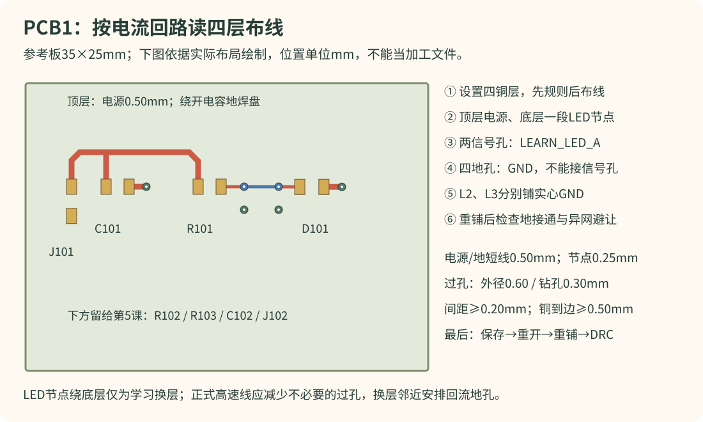

# 03 把原理图变成四层小板

[上一课](02-画出最小原理图.md) · [学习路线](README.md) · [下一课：布线铺铜](04-布线铺铜与检查.md)

## 目标、器件与接线

本课只新增“把同一电路落实到板框和元件位置”。输入必须是已完成检查的四件原理图，不新增元件、不改网络。输出是可开始布线的四层布局。

## 操作一：导入正确的 PCB

1. 保存上一课**自己新建板子中的P1**，记录所属原理图和板子名称；Board1是完成的参考，不重新往其中导入练习元件。
2. 打开自己板子下的配对PCB，使用PCB编辑器中的 **从原理图导入变更/更新PCB** 功能。也可从原理图使用“转PCB”入口，但要核对目标是自己的PCB；已有配对PCB时不要无意选择参考PCB1或正式PCB2。
3. 在变更列表检查：预期是新增 J101、R101、D101、C101，共四件，带有上一课三条网络。第一次导入不应删除正式板元件或出现几十个无关元件。
4. 确认后导入。元件可能暂放在板框外，这是等待布局，不是失败。
5. 查每个焊盘的属性或高亮网络，核对 `J101.1→LEARN_3V3`、`J101.2→GND`、`D101.1→LEARN_LED_A`。看见四个外形不等于网表已经正确。

导入后没有元件时，先确认原理图已保存、元件有封装、Board配对正确，再查看变更列表；不要为了让元件出现而把原理图和PCB各画一份互不关联的器件。

## 操作二：设置层叠和单位

在PCB的**层管理/层叠设置**中设置铜层数量为4，顺序确认如下；若已经是四层则不反复转换。不要只把右侧图层的眼睛点亮。

| 从上到下 | 本练习用途 | 本次是否布普通信号线 |
| --- | --- | --- |
| 顶层 | 元件、电源、小段信号 | 是 |
| 内层1 | 实心GND铺铜 | 否 |
| 内层2 | 实心GND铺铜 | 否 |
| 底层 | 换层练习中的信号 | 是 |

输入窗口若询问厚度，练习设总板厚1.6mm；不要编造各介质的精确厚度来保证阻抗。下单时选板厂对应四层标准叠层并复核总厚；本练习低速、无控制阻抗需求。正式板也不是给某一页原理图单独分配一个铜层。

将PCB编辑单位设成 **mm**，确认属性输入框单位。`1 mil=0.0254mm`，不是1mm。本课的数值全部为mm，不能把0.5当成0.5mil输入。可见网格选0.5mm便于摆放，实际布线保留焊盘吸附，必要时细化网格；不为对齐网格移动封装里的独立焊盘。

## 操作三：先设规则，再布线

打开PCB的**设计规则**，在默认规则和网络规则/网络类中核对以下项目。版本可能把这些分到“线宽、间距、过孔、板边”等标签；修改前看当前单位和适用对象。

| 项目 | 练习值 | 为什么 |
| --- | --- | --- |
| 普通信号线宽 | 默认0.25，最小0.20 | 四个大封装无需挤细线 |
| LEARN_3V3 电源线 | 0.50 | 练习独立电源规则；不表示0.50mm可承受任意电流 |
| GND短连接 | 0.50 | 焊盘到地孔的短连线；内层主要靠地面 |
| 铜间距 | 至少0.20 | 检查不同网络间线/焊盘/过孔/铺铜的距离，不只改线到线一项 |
| 过孔 | 外径0.60、孔径0.30 | 便于理解与常规制造；不是焊盘尺寸 |
| 铜到板边 | 至少0.50 | 给铣边留余量；检查实际铜到板框的距离 |
| 丝印参考 | 字高约1.2、笔画约0.15 | 先做到能读，再按加工方要求确认 |

若最小/默认/最大值同时出现，确保最小≤默认≤最大，且最大值允许本课使用的线宽。板厂能力若比本表更严格，使用更严格值并调整布局。

参考PCB1采用名为 `LEARN_PWR` 的0.50mm线宽规则，分别绑定到 `LEARN_3V3` 和 `GND`，没有额外建立网络类。自己的练习也可用逐网规则；网络多时再学网络类（把多条网络归为一组后套规则）。布线时还要查看实际线宽；**给网络上色不会自动设线宽**。`LEARN_LED_A`使用普通0.25mm规则，铺铜连接方式与辐条宽度另查。

练习默认0.20mm不能整体覆盖正式PCB2：正式板常规8mil约0.2032mm，U10库内焊盘间距另有7mil例外，须看正式电气说明。不要为了学习而重置正式板规则。

## 操作四：画板框并放元件

使用**板框/板外形**工具画35×25mm的闭合矩形；若使用普通图形转换，转换后确认对象确实属于板框。四条边端点相接、没有重复边或多余内框；到3D视图确认只得到一块矩形板。

以**板框左下角为(0,0)，向右为X正、向上为Y正**，按下表摆放。这个约定只用于读教程，不要求你去移动软件绝对原点。不同版本显示坐标方向可能不同，按左/右/上/下关系摆放即可。

| 元件 | 参考位置，mm | 方向和要求 |
| --- | --- | --- |
| J101 | 第1焊盘中心约(4,16) | 两针竖排，第2脚在下方、间距2.54；连接器本体完全在板内 |
| C101 | 封装中心约(8,16) | 1脚左、2脚右；紧邻输入，接地孔能就近放 |
| R101 | 封装中心约(16,16) | 1脚左、2脚右，靠近LED支路 |
| D101 | 封装中心约(25,16) | 1脚A在左、2脚K在右；看脚号，不猜标记 |

位置是布局引导，真实焊盘中心取决于库封装；不得照示意图拆封装、修改焊盘位置。旋转整个元件使脚号方向符合要求，先查看旋转后的实际网络。

全体元件先放顶面，不练习翻到底面。底层走线不要求把元件搬到背面；元件所在面与导线所在层是两件事。

预留下方约10mm空白，供第5课增加分压。现在不放安装孔，避免同时学机械设计；实物安装需求以后再加。位号贴近对应元件、方向尽量一致，不压焊盘，也不把连接器的针序藏在插头下面。

## 现象与电路解释

布局后还会看到飞线，说明软件知道两点应该相连，但你还没有画实际铜线。把两个元件拖到很近，飞线可能变短；这不代表网络已连通。两层内层也只是可用空间，下一课指定GND并重铺后才形成实际铜面。

## 常见错误

- 先随便走线、最后才定规则：改宽线后挤不下，要重来。先定规则和布局。
- 用丝印矩形当板框：3D可能无板或制造外形错误。检查板外形对象与闭合性。
- 只按3D颜色认极性：查看真实焊盘号和数据手册。
- 元件在板内但接头插不进去：应留插头、手指和线束空间；正式板还需核对USB伸出和母座间距。
- 点到焊盘单独拖动：保持封装完整，退出后选整个元件移动。

## 过关标准与最终项目的关系

- [ ] 四件元件与原理图一一对应，焊盘网名正确。
- [ ] 板框35×25mm闭合、四个铜层，3D外形正确。
- [ ] 元件在板内无重叠，极性/针序清楚，规则已设置且单位正确。
- [ ] 保存重开，规则、层数、位置保留；此时有飞线属于预期。

正式PCB2的布局也先满足接口、供电、回流和机械需求，再追求整齐。你不需要为了“好看”把去耦电容搬远，或把地面切开给信号腾位置。
