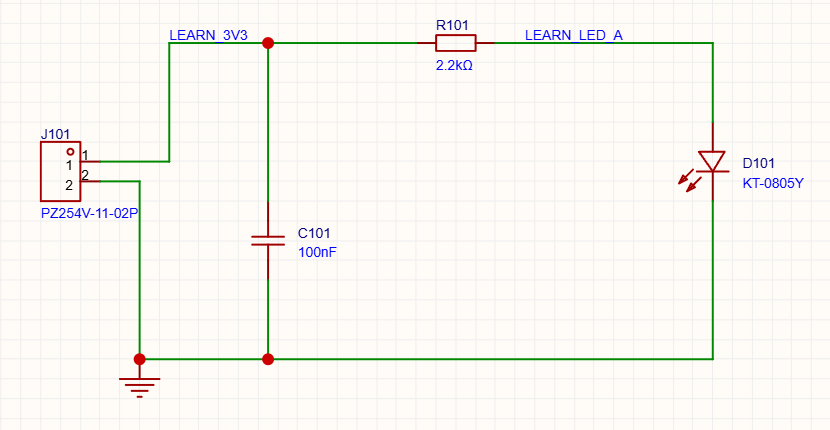

# 一步一步来

在VS Code中按 **Ctrl+Shift+V** 预览。一次只看当前一步，做到了才展开下一步。

## 第1步：只打开工程

在文件资源管理器里，双击[载板工程文件](<../HomeGuard Mini 载板 R1 20261111/HomeGuard Mini 载板 R1 20261111.eprj3>)。

**看到嘉立创左侧有Board1，就过关。先不用看电路。** 找不到文件或打不开，照[第00课开头](00-认识工程与图层.md)操作。

看到了Board1，再展开第2步

展开 **Board1 → Schematic1**，双击里面的 **P1**。

**中间出现“左边电路、右边中文说明卡”，就过关。** 先不读线和数字，也不打开PCB。

P1打开了，再展开第3步

在左边电路上方找 **R101**。按一下Esc，再单击它的小长方框本体，看右侧属性。

**看到“R101、2.2kΩ”，今天的第一小段就完成了。** 可以停下；想继续才打开[第01课](01-元器件与最小电路.md)，一次再认识一个元件。

要点软件里的长方框，不是这张图片，也不是说明卡里的文字。不需要修改数值、买元件或接开发板。

以后按什么顺序学？用到时再展开

| 顺序 | 阅读与操作                                      | 做完要拿得出的成果                                         |
| ---- | ----------------------------------------------- | ---------------------------------------------------------- |
| 0    | [找到图纸、点中元件](00-认识工程与图层.md)       | 能打开P1，点中R101并看到参数                             |
| 1    | [在现成图上认出四个元件](01-元器件与最小电路.md) | 能指出输入、电阻、LED、电容，知道它们各做什么             |
| 2    | [亲手画最小原理图](02-画出最小原理图.md)         | P1 中有四个元件、三个网络，逐脚连接与参考表一致            |
| 3    | [转成四层 PCB 并完成布局](03-转PCB与四层布局.md) | 35×25mm 板框，四铜层，元件不重叠，规则已配置              |
| 4    | [电源、地、信号布线与检查](04-布线铺铜与检查.md) | 含换层过孔、两内层 GND，保存重开后无未布通/短路/间距错误   |
| 5    | [只增加一个分压功能](05-增加分压测量.md)         | 从四件扩到八件，会导入原理图变更、重布局与重新验收         |
| 6    | [迁移到正式载板与版本管理](06-修改正式载板.md)   | 会完成改电阻、移动元件、追踪网络，并判断哪些改动需重新设计 |

第00～01课看现成参考；第02课才新建自己的练习图，一直用到第06课。第一轮做到第04课，就完成了一块小板的软件练习，不必先焊接或打样。

每课默认只看第一步，其余操作和计算折叠起来。上一小步的完成标志没达到，就留在这一步，不需要提前看后面的层数、规则或分压计算。

**Board1是参考答案，保留对照；正式载板是Board2，第06课才只读追踪。** 不要清空它们来做练习。

路线自查与验收

参考板已检查逐脚连接、元件身份、图面及制造输出，原理图ERC与两轮PCB原生DRC为0项；辅助检查另有两条已解释的线宽INFO。未打样、焊接或上电验证。

具体证据、覆盖范围和待验项统一见[现有验收清单](../../docs/10-遗留问题与验收清单.md#四层学习工程验收2026-11-18)。自己改图后仍要重新检查，不能沿用参考结果。

教程文件与工程内讲解页的关系

工程内P2是目录、P3讲图层、P4讲布局布线、P5讲正式板导航，用到时再打开。P1和PCB1是真实可编辑电路，讲解图片本身不能接线。

本目录SVG是讲解图源，JSON是逐脚连接表，不会自动导入或同步原生工程；改图源后须重新嵌入相应讲解页。整个原生工程目录和本教程随现有Git仓库管理，不要只复制入口文件，也不用另建仓库。

